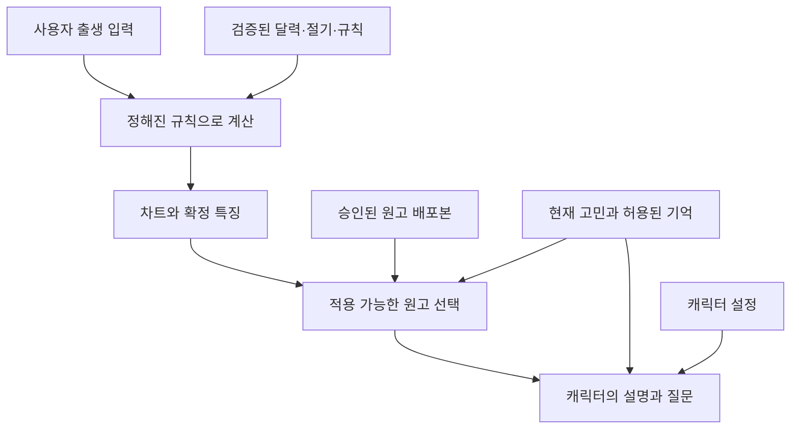

# fortune-ai-companion 사주 DB 자료 구축안

작성일: 2026-10-20, 한국시간 기준. 사용자가 제공한 백엔드 조사자료와 Baeun One·Manyfast 종합 보고서를 함께 분석한 설계 제안이다. 기존 코드·운영 DB는 확인하지 않았으며, 원천 API 인증 호출·전체 달력 수집·계산 구현·명리 검수를 수행한 결과가 아니다.

## 1. 권장 방향

**PostgreSQL 하나에서 공용 역법 자료, 계산 규칙, 검수된 해석 원고, 사용자별 결과·대화를 구분해 관리한다.** 작성자가 만드는 자료는 주로 ‘어떤 계산 특징에 어떤 설명과 질문을 붙일 것인가’이고, 프로그램은 검증된 원천과 규칙으로 사주 결과를 계산한다.

초기에는 검증한 날짜·지역 범위의 사주 원국, 출생시간 미상 처리, 단순 오행 개수, 승인된 십성 규칙, 연애 주제의 짧은 대화를 연결한다. 용신·격국·신강약·대운·궁합 점수·가중 오행은 근거와 규칙을 검수한 다음 추가한다. 이 범위는 제안이며 프로젝트의 확정 결정은 아니다.

서비스의 일관성 기준은 ‘같은 입력과 같은 계산 버전이면 같은 계산 JSON’이다. 생성형 모델이 새로 쓰는 문장까지 항상 같다는 뜻은 아니다. 미래 예측의 과학적 정확도를 측정한다는 의미도 아니다.

### 받은 자료의 활용 위치

| 자료 | DB 구축에서 활용할 부분 |
|---|---|
| 사주 백엔드 조사자료 | 원천 후보, 시간·역법 정책, 계산·해석 분리, 검증 케이스의 설계 근거 |
| Manyfast 기획·수용 기준 | 입력·수정·삭제, 파트너 일관성, 리딩 결과, 결제 권한, 운영 검수의 요구사항 |
| Baeun One 역할·작업 카드 | 담당 역할·산출물·완료 조건을 연결할 작업 관리 자료 |
| 유튜브 사례 | 캐릭터의 말투·기억·짧은 감정 진행·마케팅 소재를 기획할 참고 자료 |
| Cafe24 사례 | 자료 탐색·가공·검수·등록의 운영 흐름 참고 |

기획 문서나 영상 자막을 통째로 사주 지식 검색 대상으로 넣으면 계산 규칙, 제품 예시, 창작 내용의 경계가 사라진다. 각 자료의 위 역할에 맞춰 필요한 항목만 구조화한다.

## 2. 실제로 만들 자료와 제작 방법

| 자료 묶음 | 예시 필드 | 제작 방법 | 초기 완료 기준 |
|---|---|---|---|
| 출처대장 | 제공자, URL, 자료 종류, 이용조건, 문서 확인일 | 공식 문서 확인 및 기록 | 공개 설명 확인과 실제 데이터 검증 상태가 구분됨 |
| 원문 취득 기록 | 취득일, 요청 조건, 원문 경로, checksum, parser 버전 | 수집기가 자동 기록 | 모든 정규화 행에서 받은 원문을 찾을 수 있음 |
| 양음력 달력 | 양력 날짜, 음력 년월일, 윤달, 일진 | KASI 등 승인 원천 수집·정규화 | 선택한 지원기간의 누락·중복·왕복 변환 확인 |
| 절기 사건 | 절기 코드, 시각, 시간대, 정밀도 | 공식 자료 또는 검증된 계산 원천 | 날짜·시각·출처·정밀도까지 확보 |
| 계산 기준표 | 천간·지지·오행·십성 매핑, 경계 정책 | 작은 코드표와 규칙 파일 작성·검수 | 각 항목에 정책 버전과 검증 사례가 연결됨 |
| 특징 사전 | feature 코드, 타입, 단위, 미상 의미, 생성 규칙 | 개발자·계산 검수자 작성 | 해석 조건이 참조하는 필드 의미가 고정됨 |
| 해석 원고 | 적용 조건, 기본 문장, 질문, 근거, 판 번호 | 자체 작성 후 근거·편집 검수 | 승인된 원고만 배포본에 포함 |
| 사용자 결과·기억 | 입력 판, 차트, 리딩, 근거 메시지, 동의 | 서비스 이용 시 생성 | 사용자 소유권·수정·삭제 경로가 유지됨 |
| 검증 자료 | 입력, 기대값 원천, 정책, 실제 결과 | 독립 근거 + 경계 사례 작성 | 계획·기대값 검수·실행 통과가 구분됨 |

날짜별로 긴 운세 원고를 미리 만들 필요는 없다. 달력은 날짜별로 저장하고, 해석은 계산 특징과 사용자의 현재 고민에 맞는 작은 의미 단위로 작성한다.

## 3. 원천을 어디서 확보할 것인가

### 3.1 KASI 음양력 API

[공공데이터포털 공식 명세](https://www.data.go.kr/data/15012679/openapi.do)는 양음력, 윤달, 월일수, 일진 등 필드와 REST/XML 형식을 설명한다. 페이지의 이용조건은 무료·이용허락범위 제한 없음으로 표시된다. 지원 시간범위는 공개 화면에 명시되어 있지 않다. 실제 계정 호출·응답은 별도로 확인해야 한다. [S1]

`getLunCalInfo`의 공개 요청표는 연·월을 필수, 일을 선택으로 표시한다. 따라서 **월 단위 수집 가능 여부와 페이지 처리부터 샘플로 검증**하는 것이 좋다. 한 페이지가 월 전체라는 가정은 하지 않는다. 반환 건수·페이지·실제 날짜 집합을 비교해 완결성을 확인한다. [S1]

1900-01-01~2050-12-31을 목표로 잡는다면 양력 날짜는 **55,152행**이다. 151년의 24절기 사건은 **3,624행**이고, 경계 계산용 앞뒤 자료는 별도로 필요하다. 이는 행 수 산정이며 해당 범위의 자료를 확보했다는 뜻은 아니다. 수집 목표기간, 검증된 계산 지원기간, 성인 가입 자격은 서로 다른 설정이다.

달력 원천의 `lunWolgeon`·`lunSecha`는 받은 값 그대로 보존할 수 있다. 이를 사주 절입 월주·입춘 연주에 직접 복사하지 않는다. 원천 날짜 정보와 선택한 명리 관례의 계산 결과는 별도로 기록한다.

### 3.2 가장 먼저 확인할 공백: 과거 절기의 ‘시각’

[특일 API](https://www.data.go.kr/data/15012690/openapi.do)는 24절기를 포함한다고 설명한다. 이번 공개 기본화면에서 확인된 상세 동작은 기념일 조회이며, **24절기 전용 응답의 시각 필드·시간대·과거 범위는 인증 샘플로 검증하지 않았다.** 날짜만 확보한 상태에서 절입 시각까지 갖췄다고 표시하면 안 된다. [S2]

[KASI 월력요항 안내](https://astro.kasi.re.kr/kor/life/post/almanac)의 공개 안내는 2004년 이후 자료, 2020년 이후 관보 링크 제공을 설명한다. 따라서 이 웹 경로만으로 1990년대 출생자의 절기 시각까지 확보했다고 할 수 없다. 또한 [달력자료 안내](https://astro.kasi.re.kr/kor/life/post/calendarData)는 공식 월력요항 발표 전 자료라는 점을 구분한다. 실제 수집 시 확정본 여부를 기록해야 한다. [S3, S4]

개발 착수 시 아래를 먼저 확인한다.

1. 24절기 공식 가이드와 승인 API 응답에 시각이 포함되는가.
2. 출시 대상 출생연도까지 조회되는가.
3. 시각의 시간대, 표시 정밀도, 반올림 방식은 무엇인가.
4. 과거 자료가 부족하면 어떤 역서·공식 추가 자료 또는 라이선스와 한국 기준을 검증한 천문계산 원천으로 보완할 것인가.

확보되지 않은 구간은 `coverage_gap`으로 남긴다. 지원범위는 달력·절기·시간대·계산 정책의 검증 범위가 겹치는 구간으로 정하며, 구간 내부의 누락과 앞뒤 경계도 확인한다.

### 3.3 시간대 자료

IANA tzdb는 지역별 현지 시각의 역사와 UTC offset·서머타임 규칙을 관리한다. 출생 당시 시간대를 해석한 버전을 저장한다. 현재의 사용자 위치나 현재 UTC offset만으로 출생 시각을 처리하지 않는다. [S5]

양음력 변환 라이브러리와 종합 사주 라이브러리는 역할을 구분한다. 첨부 조사자료의 후보를 사용할 경우, 전자는 변환 어댑터로 검증하고 후자는 절입·시간대·자시 정책의 의미를 확인한 범위에서 비교한다. 패키지 이름이나 라이선스만으로 한국 사주 전체 계산의 정답을 보증하지 않는다.

## 4. 수집·정규화·배포 절차

**출처 등록 → 원문 취득 → 정규화 → 독립 대조 → 승인된 release 활성화**를 고정한다.

### 원문 기록

```text
source_snapshot
  id
  source_id
  retrieved_at
  request_parameters_without_credentials
  raw_object_uri
  raw_sha256
  parser_version
  response_status
```

API 인증키를 포함한 URL이나 요청 전체를 원문 기록에 남기지 않는다. 정상 응답 여부는 HTTP 상태뿐 아니라 본문 결과코드·필수 필드·페이지 완결성으로 확인한다. 원문 파일은 해석 문장으로 바꾸지 않고 보관한다. 긴 원문은 파일 저장소에 두고 DB는 위치와 해시를 연결해도 된다.

### 정규화 테이블

```text
calendar_day
  dataset_release_id
  solar_date
  lunar_year / lunar_month / lunar_day
  is_leap_month
  lunar_month_days
  day_cycle_index
  source_snapshot_id

solar_term
  dataset_release_id
  event_year / term_code
  instant_utc
  original_time_text / original_zone
  precision / rounding_policy
  bounds_status = exact | bounded | unknown
  instant_lower_utc / instant_upper_utc
  uncertainty_description
  source_snapshot_id
```

분 단위 시각을 `:00`초로 저장해도 초 단위 정답이 되지 않는다. 반올림 방식이 확인되지 않으면 임의로 ±30초 범위를 확정하지 않는다. 실제 원문 정밀도와 사용자가 제공한 출생시간 정밀도를 함께 고려한다.

불확실 구간의 상·하한은 근거로 도출할 수 있을 때만 저장한다. 경계 포함 여부도 함께 정의하며, 근거가 부족하면 상·하한을 비워 두고 `bounds_status=unknown`으로 유지한다.

### 자료 배포본

```text
dataset_release
  id
  calendar_coverage
  solar_term_coverage
  timezone_policy_coverage
  validated_calculation_coverage
  included_snapshot_ids
  validation_report_ref
  status
```

release는 ‘검증에 사용한 자료 묶음’이다. 숫자나 원천이 바뀌면 새 release를 만들고, 영향을 받은 계산 결과의 차이를 확인한다. 원문을 수집했다는 사실과 그 자료를 서비스에 쓸 수 있다는 승인 상태를 구분한다.

## 5. DB 구조: 하나의 PostgreSQL로 시작

PostgreSQL의 일반 컬럼·외래키와 JSONB를 함께 사용하는 구성을 권한다. JSONB는 JSON 처리와 인덱스를 지원하지만, 제품에서 필요한 필수값·범위·조건 의미는 별도로 검증해야 한다. [S6, S7]

| 영역 | 테이블 또는 자료 | 반드시 연결할 키 |
|---|---|---|
| reference | `source_registry`, `source_snapshot`, `dataset_release` | 원천 → 받은 원문 → 검증 묶음 |
| reference | `calendar_day`, `solar_term` | release ID + 날짜/절기 코드 |
| reference | `rule_set`, 기초 매핑 파일 | 정책 버전, 코드 버전, 검수 기록 |
| content | 특징 사전, 조건 사전 | feature 코드·타입, 조건 DSL 버전 |
| content | `knowledge_revision`, `content_release` | 원고 ID + 판 번호, 공개 원고 목록 |
| content | `character_revision` | 캐릭터 ID + 말투·설정 판 번호 |
| app | `birth_profile_revision`, `chart_snapshot` | 소유자, 입력 판, data/rule/code/tzdb 버전 |
| app | `reading_snapshot` | 차트, 실제 원고 판, 캐릭터, prompt/model, 출력 |
| app | `user_partner`, `conversation`, `message`, `memory_fact` | 사용자별 파트너, 근거 메시지, 동의·만료 |
| evaluation | 사례·실행 기록 | 입력·독립 기대값·정책·실행 버전 |

이 표는 논리적 자료 구분이다. 첫 단계부터 모두 독립 서버나 별도 DB로 만들 필요는 없다. 작은 기초 매핑·검증 fixture는 버전 관리되는 JSON/CSV로 시작할 수 있다. `normalized_birth`와 `chart_feature`는 초기에는 차트 내부의 스키마가 정해진 JSONB로 보관하고, 검색 요구가 생기면 분리한다. 소유자·외래키·판 번호·공개 상태는 독립 컬럼으로 관리한다.

### 첨부 설계에서 보완할 키

첨부 표의 `calendar_day.date PK`는 여러 revision을 동시에 보관하려는 설명과 충돌한다. 아래처럼 **release를 포함한 복합키**가 필요하다.

```sql
PRIMARY KEY (dataset_release_id, solar_date)

UNIQUE (
  dataset_release_id,
  lunar_year, lunar_month, lunar_day, is_leap_month
)
```

이는 키 설계 예시이며 실행한 migration이 아니다. 음력 역조회에서 윤달 여부를 빼면 평달·윤달이 충돌할 수 있다. PostgreSQL은 복합 기본키와 외래키를 지원한다. [S7]

## 6. 계산 규칙 자료는 작은 기준표부터

### 필요한 기준표

- 천간 10개: 코드·표기·음양·오행.
- 지지 12개: 코드·표기·음양·기본 오행.
- 육십갑자 60개: 인덱스와 천간·지지 연결.
- 십성 관계: 일간과 대상 천간에 따른 승인된 매핑.
- 절기 코드와 월 전환 여부: 24개 사건 중 선택한 12개 절입 매핑.
- 일·시주 계산의 기준일과 경계 규칙.

지장간 목록, 지장간 가중치, 강약, 용신은 서로 다른 규칙이다. 포함할 항목만 별도로 근거를 검수한다. 단순 표시 글자의 오행 개수를 ‘강하다·부족하다’라는 해석으로 자동 변환하지 않는다.

### 먼저 승인할 정책

| 항목 | 권장 출발점 | 아직 결정해야 하는 내용 |
|---|---|---|
| 달력 | 양력·한국 음력을 구분, 음력 윤달 별도 입력 | 다른 국가 음력 지원 |
| 연주 | 검증된 입춘 순간을 경계로 쓰는 정책 후보 | 경계 포함 규칙과 명리 검수 |
| 월주 | 12개 절입 순간을 경계로 쓰는 정책 후보 | 절기·월 인덱스와 월간 산식 검수 |
| 일주 | 승인한 관례 한 종류로 MVP 시작 | 00시·23시·야자시 관례 선택 |
| 시주 | 2시간 구간과 사용할 일간을 별도 명시 | 특히 23시대의 일간 기준 |
| 실제 출생 시각 | 출생지 IANA zone과 당시 offset/DST 적용 | 도시 매핑과 지원범위 |
| 일·시주 보정 | 실제 UTC instant와 별도 계산값으로 관리 | 법정시·DST 제외 표준시·태양시 선택 |
| 시간 미상 | 가능한 구간과 공통 특징 표현 | 대략 시각의 구간 정의 |

이 중 일경계·23시대 시주·시각 보정은 표만 채워 넣어 확정할 문제가 아니다. 채택 관례와 검수자를 정하고, 그 관례에 따른 기대값을 승인한다. 계산에 쓰는 UTC instant와 일·시주용 보정 시각을 혼동하면 절기 경계가 잘못 이동할 수 있다.

## 7. 해석 DB: ‘조건이 붙은 원고’로 작성

### 원고의 근거 유형

| `basis_type` | 의미 | 예 |
|---|---|---|
| `calculation_fact` | 현재 계산 결과를 읽는 설명 | 표시된 여덟 글자에서 특정 오행의 단순 개수 |
| `traditional_convention` | 명시한 명리 관례의 해석 | 승인된 특징을 전통적 의미로 설명 |
| `editorial_reflection` | 편집자가 만든 성찰용 질문 | 관계에서 중요하게 생각하는 것 묻기 |
| `user_context` | 사용자 발화가 뒷받침하는 상황 | 답장을 기다린다고 사용자가 말함 |
| `product_guidance` | 입력·결과·오류에 관한 안내 | 시간 미상, 일부 계산 가능, 설명 생성 실패 |

‘자체 작성’은 문장 작성 경위다. 그 문장에 담긴 명리 해석의 근거까지 검증했다는 뜻은 아니다. 원고의 근거와 문장의 작성 경위를 따로 남긴다.

### 한 원고의 구조

```text
entry_id / revision / locale
domain / content_kind / basis_type
concept_id / topic / conflict_group
applies_when_human / condition_id
neutral_text / helpful_question / forbidden_claims
basis_source_id / source_locator / text_provenance
compatible_rule_set_ids
domain_review / editorial_review / reviewers
publication_status
```

원고 담당자는 먼저 적용 조건을 한국어로 쓰고, 개발자가 검증된 `condition_id`로 연결한다. 책을 사용한다면 판본·장·페이지와 사용조건을 확인한 자료를 연결한다. AI는 허용된 자료 안에서 요약·초안을 만드는 데 사용할 수 있고, 출처나 검수자의 승인 기록을 대신 만들지는 않는다.

### 예시: 답장을 기다리는 상황

| 항목 | 원고 예시 |
|---|---|
| 유형 | `user_context` |
| 조건 | 현재 메시지에 사용자가 답장을 기다린다고 말한 근거가 있음 |
| 본문 | 답장을 기다리는 동안 신경이 쓰일 수 있어요. 지금 대화만으로 상대의 이유를 알기는 어려워요. |
| 질문 | 평소 답장 간격과 비교하면 얼마나 달라졌나요? |
| 확대하지 않을 주장 | 상대의 변심, 사주 때문에 늦은 답장, 상대가 바쁜 것이 확실하다는 추정 |
| 상태 | 자체 작성 초안, 검수 전 |

이 원고는 대화의 공감 부분이다. 사주 근거를 사용하는 설명은 별도 계산 feature와 승인된 명리 원고가 있을 때 연결한다.

### 처음 80개를 만드는 편집 계획

| 유형 | 목표 초안 수 | 검수 관점 |
|---|---:|---|
| 명리 기초 용어 설명 | 20 | 출시한 개념·관례와 근거 일치 |
| 계산값 읽기·부분 결과 | 10 | 단순 집계와 가중·해석의 구분 |
| 여러 특징을 함께 읽는 원고 | 10 | 실제 지원 규칙 내에서 조건 검수 |
| 연애 상황 대화 | 24 | 연락·표현·갈등·관계 경계 각 6개 |
| 불확실성·실패 안내 | 8 | 실제 API·화면 상태와 일치 |
| 후속 확인 질문 | 8 | 사용자가 말한 목표·허용된 기억 |
| 합계 | 80 | 초안 목표이며 공개 승인 수가 아님 |

첫 데모는 이 중 **20~30개 내외를 선별해 검수**하는 것을 권한다. 분량 목표보다 ‘필요한 모든 상황에 승인된 문장이 있는가’를 먼저 확인한다. 명리 근거가 준비되지 않은 항목은 초안으로 두고 검증된 계산 설명과 상황 대화로 범위를 제한한다.

### 제작 순서

1. 필요한 사용자 상황과 계산 feature를 먼저 목록화한다.
2. 명리 관례에 대한 문헌·규칙 근거를 지정한다.
3. 기본 문장과 후속 질문을 자체 작성한다.
4. 개발자가 적용 조건을 구조화한다.
5. 계산·명리 근거와 문장 편집을 구분해 검수한다.
6. 양성·음성·정보 미상 예시에서 노출 결과를 확인한다.
7. 승인한 원고 판을 `content_release`에 고정한다.

## 8. 조건 사전과 특징 사전

처음에는 별도 벡터 DB 없이 **주제·언어·버전 필터와 작은 조건 평가기**로 시작한다. 예를 들어 ‘수’라는 단어가 비슷한 문서를 검색하는 방식보다, ‘확정된 여덟 글자 집계에서 수가 0인가’를 정확한 필드로 검사하는 것이 목적에 맞다.

다음은 구조 설명을 위한 초안이다. 실제 제품에서 승인한 계산 규칙은 아니다.

```json
{
  "condition_id": "COND_VISIBLE_WATER_ZERO_COMPLETE_V1",
  "schema_version": 1,
  "all": [
    {"feature": "saju.known_pillar_count", "op": "eq", "value": 4},
    {"feature": "saju.visible_element_counts_status", "op": "eq", "value": "exact"},
    {"feature": "saju.visible_element_counts.water", "op": "eq", "value": 0}
  ],
  "candidate_policy": "all_candidates_true",
  "unknown_result_policy": "exclude",
  "status": "draft"
}
```

이 조건이 허용하는 설명은 **표시된 글자의 단순 집계**다. 성격·연애 결과·강약 판단은 여기서 자동으로 도출되지 않는다.

### 판정 규약

- 조건 결과는 `true / false / unknown`으로 구분한다.
- 없는 값과 실제 0은 다르다. 누락된 시주를 0개로 채우지 않는다.
- 일반 원고는 조건이 명확히 참일 때 사용한다.
- 시간 미상 안내는 시간 정밀도 상태를 직접 검사한다.
- 복수 후보에서는 모든 유효 후보에 성립하는 내용을 확정 설명으로 선택한다.
- 후보가 0개면 ‘모두 참’으로 처리하지 않는다.
- 알려진 feature와 허용된 연산만 쓰며, DB에 저장한 임의 코드나 SQL을 실행하지 않는다.
- `concept_id`가 같은 원고는 중복 제거하고, `conflict_group`이 같은 원고의 동시 출력을 제어한다.

초기 DSL은 `all`, `eq`, `in`만으로도 예제 8개를 표현할 수 있다. 복잡한 중첩과 점수 합산은 필요할 때 추가한다. 의미 검색을 도입하더라도 적용 가능성 필터를 통과한 원고 안에서 검색한다.

`rule_set`은 `feature_schema_version`을 고정하고 원고 조건은 그 특징 사전·DSL 버전과의 호환성을 검증한다. 예를 들어 단순 오행 집계의 범위를 변경하면 새 특징 사전 판을 만들고 기존 원고 조건의 의미가 유지되는지 확인한다.

## 9. 사용자 입력부터 대화까지의 흐름



런타임에서는 다음을 기록한다.

1. 원본 입력 revision과 정규화 후보.
2. 사용한 원천·정책·코드·tzdb 버전.
3. 계산 결과와 각 특징의 근거.
4. 선택한 원고 ID와 판 번호.
5. 사용한 캐릭터·prompt·모델 정보와 최종 출력.

LLM은 이미 계산한 결과와 선택한 원고를 읽고 설명한다. 없는 시주, 새로운 숫자, 상대방의 감정 등을 근거 없이 추가하면 결과 검증에서 걸러야 한다. 계산 성공과 해석 생성 실패를 별도 상태로 두고, 해석 실패 시 검수된 안내문과 계산 결과를 보여줄 수 있게 한다.

## 10. 버전·기억·개인 데이터

### 차트와 리딩은 다른 결과물

| 결과 | 고정할 정보 |
|---|---|
| `chart_snapshot` | 입력 revision, dataset release, rule set, engine code, tzdb, 후보·특징·trace |
| `reading_snapshot` | 차트, content release, 실제 원고 판, 캐릭터 판, prompt, 모델 metadata, 최종 문장 |

원고를 다듬었다고 과거 차트를 바꾸지 않는다. 과거 저장 문장을 다시 보여주는 것과 새로 생성하는 것을 구분한다. 개인 고민·기억이 들어간 리딩은 사용자 간 공용 캐시로 공유하지 않는다.

### 사용자 기억

공용 캐릭터 설정, 사용자별 파트너 관계, 실제 사용자 발화를 분리한다.

```text
memory_fact
  owner_id / user_partner_id
  kind = stated_fact | preference | goal
  value
  evidence_message_id
  consent_state
  valid_from / expires_at
  supersedes_memory_id
  deletion_state
```

‘사용자가 연락을 자주 하는 편이 좋다고 말했다’는 유효한 발화 근거가 있을 때 기억 후보가 된다. ‘사주에서 불안해 보인다’는 해석을 사용자의 실제 성격으로 저장하지 않는다. 기억 사용 동의는 제품의 설정·범위로 설계할 수 있으며 매 대화마다 확인창을 띄워야 한다는 뜻은 아니다.

출생 입력·개인 차트·기억은 사용자별 접근을 제한하고, 원문 메시지·계정·프로필 삭제가 관련 요약·기억·캐시까지 반영되는 경로를 둔다. 불변 snapshot은 이전 결과를 조용히 덮어쓰지 않는다는 뜻이며 사용자 데이터 삭제를 금지한다는 뜻은 아니다. 식별키에 생년월일 원문을 넣지 않는다.

가입 연령 확인의 결과, 사주용 출생 프로필, 파트너 유형·호칭은 별도 의미의 필드다. 결제 데이터는 상품·권한·결제 이벤트로 관리하며, 무료·유료 여부가 동일 입력의 사주 원국을 바꾸지 않도록 한다.

## 11. 별자리·타로 확장

| 공통으로 재사용 | 유형마다 따로 둘 자료 |
|---|---|
| 원고 작성·근거 검수·공개 상태·판 번호 | 사주의 출생 정규화·차트·규칙 |
| 주제·언어·캐릭터 말투·생성 결과 추적 | 별자리의 지원 체계·판정 방식·계산 근거 |
| 사용자 고민·허용된 기억·후속 질문 | 타로의 덱·카드·배열 위치·방향·뽑기 이벤트 |

타로는 카드 의미 원고와 이번에 실제로 뽑힌 카드 목록을 분리한다. 세 장을 뽑는다면 `draw_id, deck_revision, spread_revision, position, card_id, orientation`을 저장하고 결과 화면도 그 세 장을 참조한다. 같은 리딩을 다시 열 때는 저장된 뽑기 결과를 사용한다.

별자리는 생일 구간 콘텐츠인지 정밀 출생차트인지 범위를 먼저 표시한다. 세 유형을 함께 읽더라도 근거를 구분한다. 기획 시안의 연애 감정 지수·궁합 점수·별점은 산식과 의미를 정의하기 전까지 실제 데이터처럼 채우지 않는다.

## 12. 검증 자료를 만드는 방법

검증 케이스에는 `case_id, input, expected, reference, policy_version, reviewer, status`를 둔다. 실행 기록은 별도로 `run_id, case_revision, engine/data/rule versions, actual, passed/failed`를 남긴다.

| 검증 범주 | 무엇을 확인하는가 |
|---|---|
| 양음력·윤달 | 독립 원천 대조, 왕복, 존재하지 않는 날짜, 윤달 모름 |
| 절기 | 입춘·12절입 전후, 월 경계가 아닌 절기, 원천 정밀도 |
| 자시 | 22:59·23:00·23:59·00:00·00:59·01:00의 승인 정책 |
| 시간대 | 지원범위의 역사적 offset, DST gap/fold |
| 시간 미상 | 일반일과 입춘·절입일의 공통 특징·후보 |
| 수집 실패 | 본문 오류, 누락·중복·페이지 불완전, 미검증 release 차단 |
| 해석 | 조건 참·거짓·미상, 원고의 근거 일치, 중복·상충 |
| 사용자 데이터 | 소유권, 허용된 기억, 변경·삭제 전파 |
| 버전 변경 | 원천·규칙·원고를 각각 바꿨을 때 결과 차이 |

독립 근거가 있는 핵심 사례를 먼저 승인한다. 이후 그 경계 주변의 자동 파생 테스트를 늘린다. 같은 엔진으로 만든 기대값은 회귀 검증에는 쓸 수 있지만 독립적인 정답 검증으로 집계하지 않는다. 템플릿의 16개 행은 **검증 계획**이고 통과한 테스트 16개가 아니다.

## 13. 10월 25일까지의 산출물 제안

현재는 10월 20일이므로 첨부 자료의 18~19일 계획을 완료된 것으로 가정하지 않는다. 기존 인증·배포·DB 기본틀의 유무도 아직 확인되지 않았다.

| 날짜 | 목표 산출물 | 미확보 시 처리 |
|---|---|---|
| 10/20 | 자료목록, 출처대장, 계산 정책 후보, 지원범위 표 | 결정이 필요한 항목을 그대로 표시 |
| 10/21 | 실제 원천 샘플, checksum, 달력·절기 정규화, 누락표 | 과거 시각·범위를 검증하지 못하면 확대하지 않음 |
| 10/22 | 검증 범위의 입력→차트 JSON→근거 trace | 계산용 원천이 부족하면 검증된 fixture 데모로 제한 |
| 10/23 | 선별 원고 20~30개 내외의 검수·조건 연결 | 승인된 소수만 사용하고 나머지는 초안 유지 |
| 10/24 | 중요 경계·해석 조건·원천 실패·삭제 테스트 | 계획·실행·통과를 구분해 보고 |
| 10/25 | 정책·자료사전·출처·seed·검증 보고·제한 범위 데모 | 실제 완료 범위를 표시하고 남은 과제 인계 |

완료의 핵심은 **출생 입력 하나에서 계산 결과와 해석의 근거까지 따라갈 수 있는 흐름**이다. 가입·결제·구독·전체 대화 운영까지 포함한 상용 출시 일정은 따로 산정한다.

## 14. 함께 제공하는 템플릿 사용법

`saju_db_workbook.xlsx`는 다음 7개 시트로 구성한다.

1. 제작계획: 80개 원고 구성과 10월 20~25일 작업 순서.
2. 해석원고: 직접 작성한 8개 초안과 적용 조건·질문·작성 경위.
3. 조건사전: 원고 선택 조건 8개와 특징 정의 17개.
4. 검수대장: 근거·문장 검수 담당자와 상태를 입력할 공간.
5. 출처대장: 공식 자료와 조사자료의 역할, 확인·미확인 상태.
6. 계산정책: 제안과 결정 필요 항목 12개.
7. 검증계획: 독립 기대값과 실행 결과를 채울 사례 16개.

`saju_db_examples.json`에는 원고·조건·특징·정책·검증 계획을 구조화해 둔다. 모든 원고는 `draft`이고 `publishable=false`다. 실제 명리 관례의 의미를 승인하지 않았으므로 `traditional_convention` 원고는 예제에 포함하지 않았다. 달력 날짜별 원본, 확정 절기 시각, 실제 사용자 정보는 들어 있지 않다.

원고를 고칠 때 같은 `entry_id`의 revision을 올리고 적용 조건·검수대장도 같은 판을 가리키게 한다. 승인된 근거·검수자·호환 규칙을 채운 후에만 운영용 `content_release`를 만든다. 엑셀만 DB에 올렸다고 적용 조건 평가·계산 API·삭제 기능이 구현되는 것은 아니다.

JSON은 제공 시점의 초안이다. 엑셀을 수정해도 JSON에 자동 반영되지는 않는다. 운영 반입 시에는 같은 판의 원고·조건·검수 기록을 읽는 변환 절차를 만들고, ID 참조·필수값·승인 상태를 검사해 새 배포본을 생성한다.

## 15. 출처와 확인 범위

- 사용자 제공 자료 A: `saju-backend-research(1).md`, 조사 기준 2026-10-18. 계산·DB 설계와 검증 계획을 참고했다. 실제 API 호출·전수 검증 완료 보고가 아니다.
- 사용자 제공 자료 B: 이 대화에 붙인 Baeun One·EJ Org 내부·외부 종합 조사보고서, 조사일 2026-10-18. Manyfast 요구사항과 작업·구현 상태는 제공 보고서에 근거한다. 이번 작업에서 해당 내부 서비스에 로그인하거나 다시 조작하지 않았다.
- [S1 한국천문연구원 음양력 API](https://www.data.go.kr/data/15012679/openapi.do): 공개 필드, 요청표, 이용조건 확인. 인증 응답·전체 지원기간 미검증.
- [S2 한국천문연구원 특일 API](https://www.data.go.kr/data/15012690/openapi.do): 서비스 범위와 공개 기본 상세 확인. 24절기 전용 시각 응답 미검증.
- [S3 KASI 월력요항](https://astro.kasi.re.kr/kor/life/post/almanac): 공식 자료 제공 안내·연도 범위 확인. 전 연도 자료 수집 미실행.
- [S4 KASI 달력자료](https://astro.kasi.re.kr/kor/life/post/calendarData): 공식 발표 전 자료라는 안내 확인.
- [S5 IANA Time Zones](https://www.iana.org/time-zones): 역사적 현지 시각·offset·DST 데이터의 역할 확인.
- [S6 PostgreSQL JSON Types](https://www.postgresql.org/docs/current/datatype-json.html): JSONB 저장·인덱스 기능 확인.
- [S7 PostgreSQL Constraints](https://www.postgresql.org/docs/current/ddl-constraints.html): 복합키·참조 무결성 기능 확인.

공식 웹 자료 확인일은 2026-10-20이다. 이 문서의 테이블명·필드·편집 수량·작업 순서·검수 방식은 위 자료에 대한 설계 제안이며, 도입·승인·운영 완료 사실로 표시하지 않는다.
